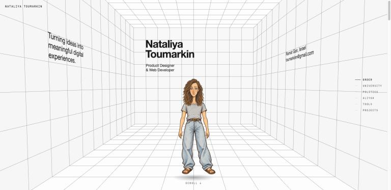
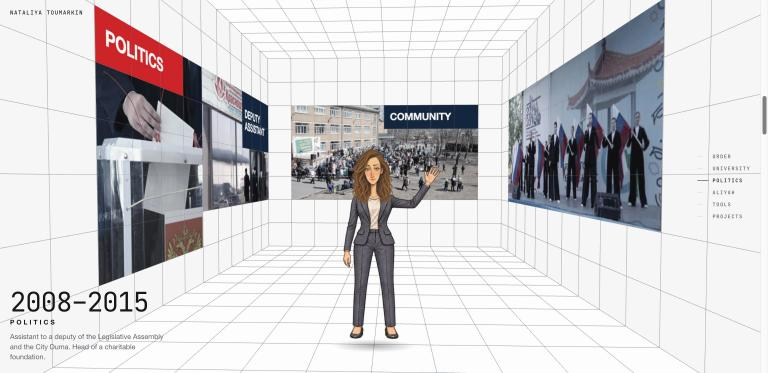
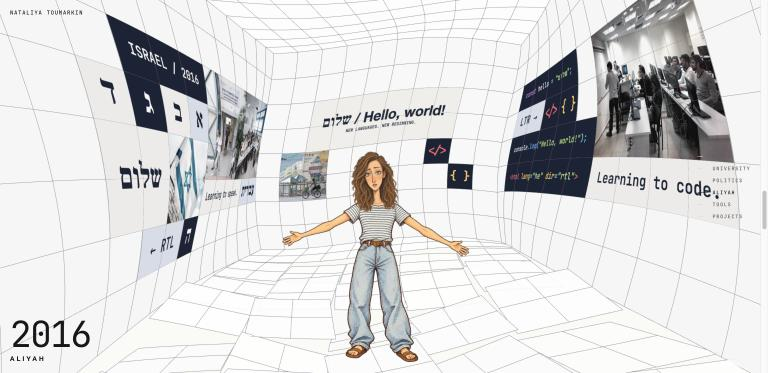
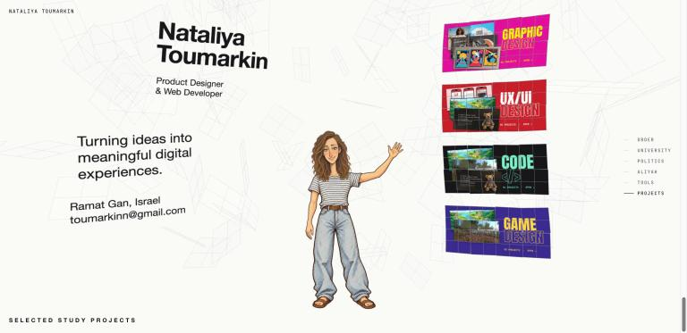
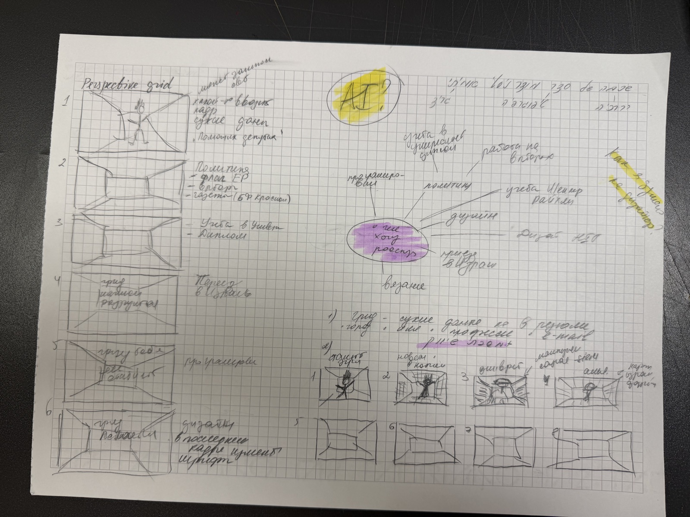
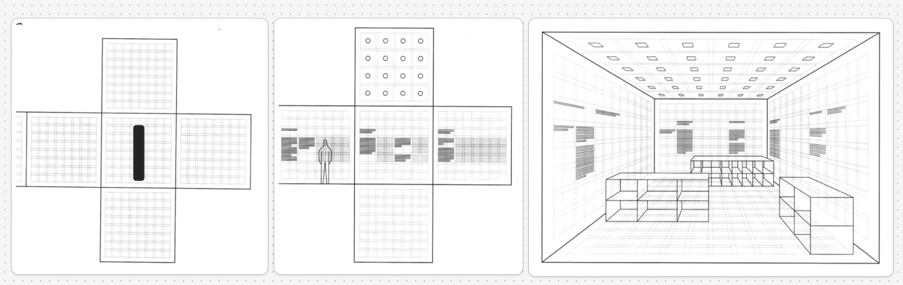
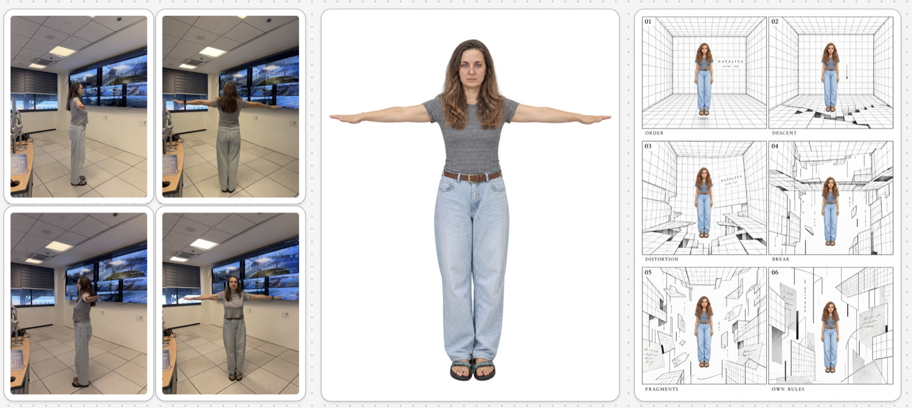
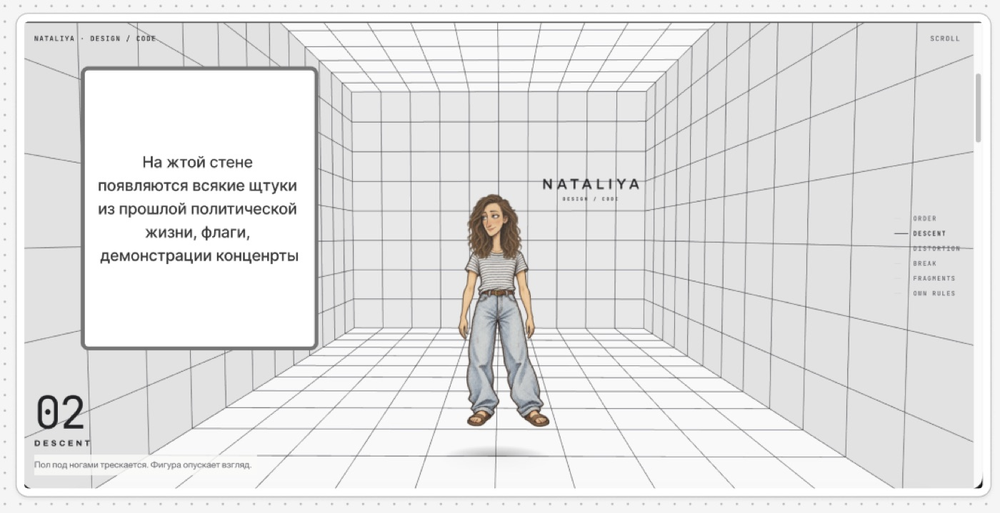

# תעודת זהות — סדר ושבירה
**נטליה טומרקין · Product Designer & Web Developer**

עמוד web אישי שמספר את הדרך שלי בגלילה.

## הרעיון

במרכז עומדת **דמות מרכזית** שמייצגת אותי. בזמן הגלילה היא עוברת את הדרך שלי: תואר באוניברסיטה, עבודה בפוליטיקה, עלייה לישראל, לימוד עברית ותכנות, ולבסוף לימודי עיצוב. בסוף מוצגים פרויקטים נבחרים מהלימודים.

- **הסדר** — חדר שבנוי מרשת פרספקטיבה: נקודת מגוז אחת, משבצות שוות, טיפוגרפיה שיטתית. כך נראו החיים שלי לפני העלייה — לפי הכללים.
- **השבירה** — אחרי העלייה הרשת נסדקת, מתעקמת ומתפרקת. בתוכה מופיעים חומרים אישיים: צילומים מהעבודה בפוליטיקה, האולפן, הכלים שלמדתי. בסוף החלקים מתחברים לסדר חדש — לפי הכללים שלי.

**השלבים:** Order → University → Politics → Aliyah → Tools → Projects

<table>
<tr>
<td></td>
<td></td>
<td></td>
</tr>
</table>

## תהליך העבודה

1. **סקיצות ומפת חשיבה** — שאלה מרכזית: איך הפכתי למעצבת? ממנה נולד סטוריבורד של רשת שמתפרקת.
2. **תכנון החדר** — שרטוט פרוש של החדר, קנה מידה ופרספקטיבה.
3. **הדמות** — הצטלמתי בתנוחת T מארבעה צדדים, ועל בסיס הצילומים נוצרה הדמות.
4. **אב-טיפוס** — רשמתי על הקירות מה יופיע בכל שלב.

<table>
<tr>
<td></td>
<td></td>
</tr>
<tr>
<td></td>
<td></td>
</tr>
</table>

